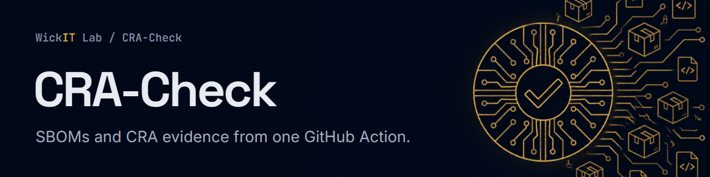

<p align="center">
  
</p>

**A free GitHub Action that turns every build into EU CRA evidence.**

CRA-Check generates a CycloneDX SBOM (via Syft), scans it for known vulnerabilities (via Grype), inspects the repository for security-policy evidence, and emits a machine-readable `cra-evidence.json` plus a human-readable `cra-report.md` mapped to EU Cyber Resilience Act requirements (Annex I Part II, Annex VII).

It is a composite GitHub Action plus one dependency-free Python script (`cra_report.py`). It runs entirely on the GitHub runner: no server, no account, nothing leaves your CI. Use it as `uses: wickitlab/CRA-Check@v1`.

> **Not legal advice.** Engineering tooling and guidance; it does not by itself guarantee CRA compliance.

## Contents

- [Tech stack](#tech-stack)
- [Prerequisites](#prerequisites)
- [Getting started](#getting-started)
- [Features (built)](#features-built)
- [Inputs](#inputs)
- [Run the report generator locally](#run-the-report-generator-locally)
- [Apify Actor (not published)](#apify-actor-not-published)
- [State of CRA Readiness](#state-of-cra-readiness)
- [Security](#security)
- [What's not yet built](#whats-not-yet-built)
- [License](#license)

## Tech stack

| Layer | Technology |
| --- | --- |
| Action | Composite GitHub Action (`action.yml`), scanners pinned by version |
| SBOM | Syft (CycloneDX JSON) |
| Vulnerability scan | Grype |
| Report generator | Python 3, standard library only (`cra_report.py`) |
| Tests | pytest, run in CI on every push and pull request |

## Prerequisites

- A GitHub repository with Actions enabled. That is all: the Action installs pinned Syft and Grype into the runner's temp directory at run time.
- To run the report generator locally: Python 3.10 or newer.

## Getting started

1. Add a workflow to the repository you want evidence for, for example `.github/workflows/cra-check.yml`:

   ```yaml
   name: CRA evidence
   on:
     push:
       branches: [main]
     pull_request:

   jobs:
     cra:
       runs-on: ubuntu-latest
       steps:
         - uses: actions/checkout@v4
         - uses: wickitlab/CRA-Check@v1
           with:
             path: '.'
             fail-on: 'off'   # set to 'critical' to block releases on critical CVEs
   ```

2. Push or open a pull request. Each run uploads `cra-sbom.json`, `cra-evidence.json` and `cra-report.md` as a build artifact and posts the report to the GitHub job summary.

See `example-workflow.yml` for a complete pipeline.

## Features (built)

### CRA gap checks

CRA-Check emits **14** gap checks (each `pass`, `warn` or `fail`) across four evidence sources:

| Source | Checks |
| --- | --- |
| **Vulnerabilities** | no Critical at release, remediate High and above, no **known-exploited (CISA KEV)** finding, no **unfixable** Critical or High, **fix-available** triage, scan **DB freshness** |
| **SBOM** | SBOM present, product declared as `metadata.component`, generation **provenance** (timestamp and tool), component **identifiers** (purl or CPE plus version), component **license** coverage |
| **Repository** | **coordinated vulnerability disclosure** policy (`SECURITY.md` or `security.txt`), RFC 9116 **`security.txt`** |
| **Process** | a vulnerability scan was run |

Hard requirements `fail` (missing SBOM, a Critical at release, a known-exploited CVE, no disclosure policy); SBOM-quality and advisory signals `warn`, so they never block a release on their own. Each check cites the CRA Annex I or Article obligation it supports. The severity-based checks use scanner severity as a practical engineering signal toward the CRA's "no known exploitable vulnerabilities" requirement; they are evidence for your assessment, not a legal determination of exploitability.

### Artifacts

| Artifact | Purpose |
| --- | --- |
| `cra-sbom.json` | Current CycloneDX SBOM (CRA Annex I Part II and Annex VII) |
| `cra-evidence.json` | Machine-readable CRA gap checks and vulnerability counts |
| `cra-report.md` | Readable summary, also rendered in the GitHub job summary |

## Inputs

| Input | Default | Meaning |
| --- | --- | --- |
| `path` | `.` | Directory to scan; also the repository root for the security-policy evidence checks |
| `fail-on` | `off` | Exit policy: `off`, `high` or `critical` |
| `artifact-name` | `cra-evidence` | Name of the uploaded evidence artifact |

## Run the report generator locally

Run it against existing scanner output (a Syft CycloneDX SBOM and, optionally, a Grype JSON result):

```bash
python cra_report.py --sbom cra-sbom.json --grype grype.json --repo-dir . \
  --out-json cra-evidence.json --out-md cra-report.md
```

Further options: `--db-max-age-days` (vulnerability database freshness threshold, default 7) and `--fail-on` (`off`, `high` or `critical`). To run the tests:

```bash
pip install pytest cryptography==49.0.0
pytest -q
```

## Apify Actor (not published)

An Apify Actor wrapping this engine is in the repository (`apify_actor/`, `.actor/`) and is not published yet. Once it is, it will take an SBOM (CycloneDX or SPDX) by URL or pasted JSON, an optional Grype result and a few product facts, and return the same 14 checks as a dataset item plus `cra-evidence.json` and `cra-report.md`, billed per report. Until a Store link is added here, treat it as not available.

With the `sealed` option it also writes `cra-evidence-sealed.json`, a signed copy in [ProofLog](https://github.com/wickitlab/ProofLog)'s evidence format that anyone with the publisher's public key can verify later (`python -m apify_actor.verify`, or ProofLog in .NET). A sealed run is billed as a sealed report instead of a plain one. The report dates follow Article 71 of Regulation (EU) 2024/2847: the Article 14 reporting obligations apply since 11 September 2026 and the Regulation applies in full from 11 December 2027.

How sealing and verification work is in [HOW_IT_WORKS.md](HOW_IT_WORKS.md). Pricing notes are in [docs/apify-pricing.md](docs/apify-pricing.md) and draft listings for AI-tool directories are in [docs/listings/](docs/listings/).

## State of CRA Readiness

[`state-of-cra/`](state-of-cra/) is a survey scaffold. It aggregates many `cra-evidence.json` files into one ecosystem readiness report: the share of projects shipping with an SBOM, with unresolved Critical findings, with a disclosure policy, and a per-check pass rate. Run it against the bundled synthetic samples with `python state-of-cra/aggregate.py`; see [state-of-cra/README.md](state-of-cra/README.md) to produce a real survey.

## Security

CRA-Check runs inside your CI and sends no data anywhere. The one network step is installing Syft and Grype at pinned versions (installer scripts fetched from the Anchore repositories at the matching tags) into the runner's temp directory. The upload-artifact step in `action.yml` is pinned to a commit SHA.

Report vulnerabilities privately through GitHub's private vulnerability reporting (the repository's Security tab, then Report a vulnerability). Do not open a public issue for security problems. See [SECURITY.md](SECURITY.md).

## What's not yet built

From the roadmap and the code:

- EOL (end-of-life) component detection alongside the CVE checks.
- A `--format html` report variant.
- Aggregate mode (one report across many repositories); `state-of-cra/` is the scaffold for it.
- The Apify Actor is built but not published, and the real State of CRA Readiness survey has not been run.

The dossier generation layer (Annex VII technical documentation, Article 14 incident drafts, continuous CVE watch, tamper-evident evidence ledger) is the commercial **CRADesk** product line built on top of this Action, together with the [ProofLog](https://github.com/wickitlab/ProofLog) tamper-evident audit-log SDK and the [SecureCheck](https://github.com/wickitlab/SecureCheck) security-scan workflow.

## License

This project is licensed under:

- [Apache 2.0](LICENSE) - free for any use, commercial or otherwise. See the license for full terms.
